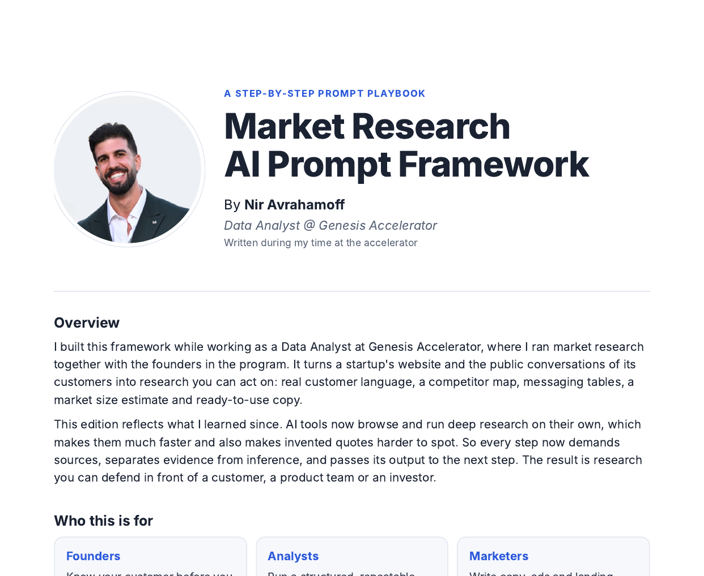

# Market Research AI Prompt Framework

A structured prompt framework for running fast, evidence-based market research with AI, built for early-stage startups.



It turns a startup's website and the public conversations of its customers into research you can act on: real customer language with sources, a competitor map, messaging tables, a market size estimate and ready-to-use positioning.

I built the first version while working as a Data Analyst at Genesis Accelerator, where I ran market research together with the founders in the program. This version rebuilds it around one lesson: AI research tools are fast and convincing, which makes their mistakes hard to see. So every prompt demands sources, separates evidence from inference, and reports its own gaps.

## Who it is for

**Founders** who want to know their customer before they build, and pitch investors with evidence instead of assumptions.

**Analysts** who need a structured, repeatable research process with every claim traceable.

**Marketers** who want copy that sounds like it came from inside the community.

## Two versions

| | [Full Version](full-version/README.md) | [Quick Version](quick-version/README.md) |
|---|---|---|
| **Format** | 8 chained prompts | 1 prompt for a research agent |
| **Time** | 3 to 4 hours, plus customer calls | 20 to 30 minutes |
| **Depth** | 6 quote categories, awareness levels, desire ladders, feature mapping | 4 quote categories, a short desire and feature map |
| **Competitors** | Up to 8 alternatives with review complaints and gaps | Up to 5 alternatives |
| **Market sizing** | Bottom-up TAM, SAM and SOM with sensitivity check | Not included |
| **Validation** | Quote audit, cross-model critique, customer conversations | A gaps list to check by hand |
| **Best for** | Investor decks, positioning, product decisions | A first look, meeting prep, testing your sources |

Not sure? Start with the Quick Version. If the results are promising, or you need something you can defend, run the Full Version.

## Repository structure

```
market-research-prompt-framework/
├── README.md                  You are here
├── full-version/
│   ├── README.md              Overview, flow, rules, sources, strengths and limitations
│   └── steps/
│       ├── 01-research-brief.md
│       ├── 02-voice-of-customer.md
│       ├── 03-competitor-landscape.md
│       ├── 04-awareness-levels-and-desires.md
│       ├── 05-feature-to-benefit-ladder.md
│       ├── 06-market-sizing-sanity-check.md
│       ├── 07-validate.md
│       └── 08-build-assets.md
├── quick-version/
│   └── README.md              The one-prompt version
└── pdf/
    ├── README.md
    ├── Market-Research-AI-Prompt-Framework.pdf   The full guide as a designed PDF
    └── cover.png
```

Each step file explains what the step does, what you paste in, what you get back and how to run it, followed by the prompt in a copyable block.

## Prompt engineering principles used

These are the design choices that separate this framework from a list of prompts.

**A consistent structure.** Every prompt follows Role, Goal, Context, Task, Rules and Output. The model always knows who it is, why it is working, what it has to work with, what it must not do, and exactly what shape to return.

**Chaining instead of repeating.** Step 1 produces a Research Brief that every later step reads, and each step names the earlier outputs it needs. The research builds on itself, and each link in the chain can be checked before it feeds the next one.

**No quotas on evidence.** Asking for "100 quotes" pushes a model to invent the ones it cannot find. The prompts set a range, allow the model to stop when real material runs out, and ask it to report thin evidence instead of filling it.

**Evidence and inference kept apart.** Every quote needs a link and a date, every number needs a source or is labelled `[Assumption]`, and every conclusion is tagged `[Inference]`. The reader always knows what was found and what was guessed.

**Built-in self-reporting.** Every output ends with its own gaps. A model asked to say what it could not find is less likely to cover it up.

**A human in the loop where it matters.** Validation does not stop at asking another AI. It includes a hand audit of sources and real customer conversations, because no model can confirm that a post exists.

**Grounded in proven frameworks.** The awareness levels and desire ladders come from Eugene Schwartz's *Breakthrough Advertising*, which gives the model a precise method instead of a vague request for insights.

## Getting started

1. Pick a version from the table above.
2. Open the prompt file and copy the prompt block.
3. Replace every `[BRACKET]` with your own content.
4. Run it in any AI tool with web browsing (ChatGPT, Claude, Gemini or Perplexity).

Prefer reading it as one document? Download the [PDF guide](pdf/Market-Research-AI-Prompt-Framework.pdf).

## Credits

The awareness levels and desire work draw on Eugene Schwartz, *Breakthrough Advertising* (1966). The verbatim quote harvest adapts a voice-of-customer prompt pattern widely shared in marketing communities. The step chaining, competitor and sizing steps, evidence tagging, validation layers, asset step and quick version are original to this framework.

## Author

**Nir Avrahamoff**, Data Analyst. Framework first created at Genesis Accelerator (2024 to 2026).

[GitHub](https://github.com/NirAvrahamoff)
