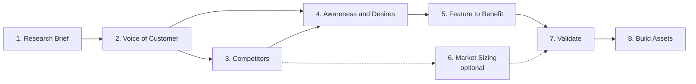

# Full Version: The 8-Step Framework

The complete process, built for research you will put in front of customers, a product team or investors. Each step is its own prompt, and each one takes the outputs of the steps before it, so the research builds on itself instead of starting over every time.

## How the steps connect

The Research Brief from Step 1 is pasted into every later step.

## The steps

| Step | Name | What you get | Browsing | Time |
|---|---|---|---|---|
| 1 | [Research Brief](steps/01-research-brief.md) | Research Brief (save it, you will paste it into every later step) | Yes | 15 min |
| 2 | [Voice of Customer](steps/02-voice-of-customer.md) | Voice of Customer file: quotes by category and theme, persona sketch, gaps | Yes | 30-60 min |
| 3 | [Competitor Landscape](steps/03-competitor-landscape.md) | Competitor table, review complaints, positioning gaps | Yes | 30 min |
| 4 | [Awareness Levels and Desires](steps/04-awareness-levels-and-desires.md) | Awareness table, desire ladder table, Will / Won't / Can't Tell table | No | 15 min |
| 5 | [Feature-to-Benefit Ladder](steps/05-feature-to-benefit-ladder.md) | Ranked feature table, lead features, orphan features | Yes | 15 min |
| 6 | [Market Sizing Sanity Check](steps/06-market-sizing-sanity-check.md) *(optional)* | Assumptions table, TAM / SAM / SOM with formulas, sensitivity check | Yes | 20 min |
| 7 | [Validate](steps/07-validate.md) | Quote audit, evidence ratings, five customer conversations | Partly | About 1 hour, plus calls |
| 8 | [Build Assets](steps/08-build-assets.md) | Positioning statement, message house, headlines, pitch slide | No | 15 min |

## How to use it

1. Run the steps in order, one prompt per message. Use a research or browsing mode for Steps 1, 2, 3, 5 and 6.
2. Keep one working document. Save each step's output under its step name, because later steps ask for earlier outputs by name.
3. Replace every `[BRACKET]` in a prompt. An empty bracket is the most common reason a step returns generic results.
4. If your tool supports Projects or custom instructions, store the Research Brief there instead of pasting it every time.
5. When everything is done, upload the full file to a fresh session and keep asking it questions. It becomes a research assistant that knows your market.

## Three rules behind every prompt

**Real or nothing.** Every quote needs a working link. AI models will happily invent believable quotes to reach a target number, so there are no quotas. Ten real quotes beat a hundred invented ones.

**Label inference.** Anything the model concludes rather than finds is tagged `[Inference]`. Facts and guesses both have value, but you should always know which one you are looking at.

**Say what is missing.** Every output ends with its gaps and weak spots. A research file that admits what it does not know is one you can trust with the rest.

## Choosing sources

Reddit is a great source for US consumer and tech audiences, but it skews young, male, American and English-speaking. Pick sources where your actual customers spend time.

| Your market | Where to look |
|---|---|
| B2B software | G2, Capterra and TrustRadius reviews, public industry forums, LinkedIn* |
| Consumer products | Amazon reviews of competitor products, Reddit, TikTok and YouTube comments |
| Mobile apps | App Store and Google Play reviews of competing apps, Reddit |
| Local or Israeli market | Local forums, Google Maps reviews, Hebrew YouTube comments, Hebrew Facebook groups* |
| Professional services | Niche professional forums, Google reviews, Quora, LinkedIn* |

\* Private Facebook groups and LinkedIn sit behind a login, so AI tools usually cannot read them. Collect those posts yourself and paste them into the optional slot in Step 2. Quotes stay in their original language, with an English translation added.

## Strengths and limitations

**Where it is strong**

- Every claim is traceable. Quotes carry links and dates, numbers carry sources, and guesses are tagged.
- Each stage can be checked and corrected before it feeds the next one, so one bad output does not silently spoil the rest.
- It covers the full path from raw customer language to finished positioning and copy.
- It works with any AI tool that can browse, and it is not tied to one vendor.

**Where it falls short**

- It takes time: roughly 3 to 4 hours of AI work plus customer calls, with manual copy-paste between steps.
- It only sees public conversations. Customers who do not post online, which is common in B2B and in older audiences, are underrepresented.
- Links reduce invented quotes but do not eliminate them, because a model can invent a URL too. The audit in Step 7 is a sample, not a full check.
- Market sizing done by an AI is a starting point. The numbers are only as good as the sources it finds.
- It does not replace customer interviews, surveys or real usage data. It tells you what to ask about, and Step 7 is where real people come in.

Short on time? See the [Quick Version](../quick-version/README.md).
